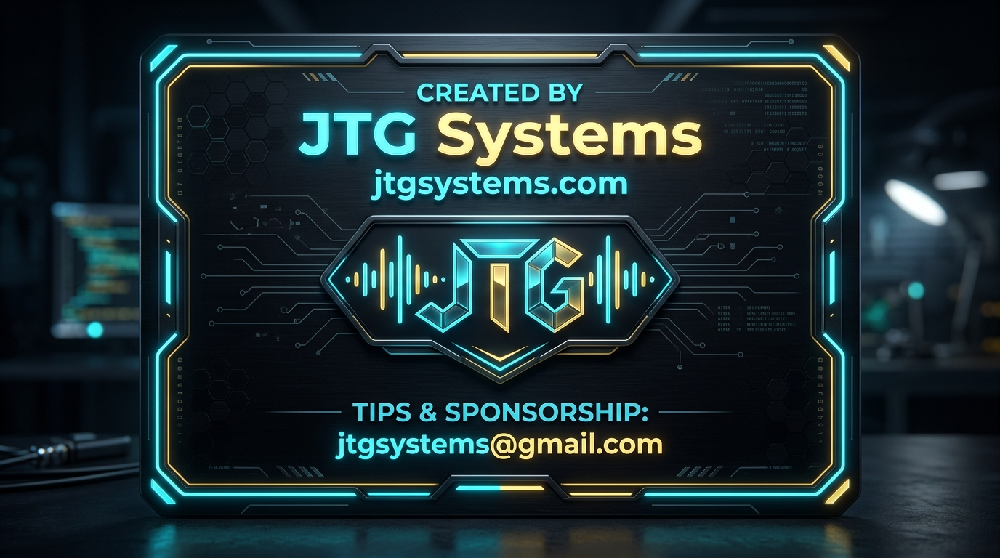

# 🔱 JTG Systems

**Enterprise Systems Architecture, Custom Workstations & AI Solutions**

🌐 **Website**: [jtgsystems.com](https://jtgsystems.com)  
📞 **Contact / Phone**: (905) 892-4555  
☕ **Tips & Sponsorship**: `jtgsystems@gmail.com`

---

### 🚀 Featured Open Source Tools & Projects

- 🔊 **[SurroundSoundMonitorSetup](https://github.com/jtgsystems/SurroundSoundMonitorSetup)** — Automatic Multi-Monitor Spatial Audio & Soundstage Calibrator for Linux.
- 🚀 **[seo-image-converter](https://github.com/jtgsystems/seo-image-converter)** — AI-Powered SEO Image Converter & Optimization Engine.
- 🦙 **[Ollama-Menu](https://github.com/jtgsystems/Ollama-Menu)** — Interactive AI Model Management & Launcher for 160+ LLMs.
- ⚡ **[AI-ASIC-Simulator](https://github.com/jtgsystems/AI-ASIC-Simulator)** — Physical reservoir computing simulation framework for AI/ML workloads.

---

### ☕ Support & Sponsorship

If you find our open-source tools helpful and would like to support ongoing development:
- **Direct Tips / Sponsorship**: Send to `jtgsystems@gmail.com`
- **Commercial & Custom Inquiries**: Visit [jtgsystems.com](https://jtgsystems.com) or call `(905) 892-4555`.

© 2026 [JTG Systems](https://jtgsystems.com). All rights reserved.
